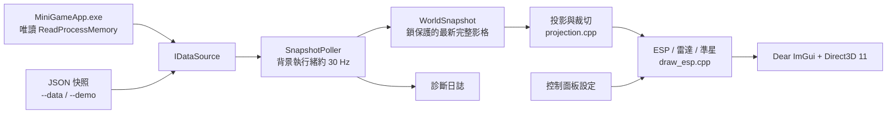

# MCP ESP Overlay

[繁體中文](README.md) · [English](README_EN.md) · [詳細編譯與使用步驟 / Detailed build and usage guide](docs/GETTING_STARTED.md)


一個以 C++20、Win32、Direct3D 11 和 Dear ImGui 建立的 Windows 即時資訊 Overlay 範例。程式把資料讀取、世界座標投影、繪圖和操作介面分成獨立模組，適合用來學習即時資料可視化、渲染管線與可替換資料來源的設計。

> **資料來源說明：**一般啟動時由 C++ 程式直接以唯讀 `ReadProcessMemory` 讀取相容版本的 MiniWorld 遊戲進程；執行時不需要 Cheat Engine MCP。CE MCP 曾用於開發時確認遊戲資料與函數。`--data` 和 `--demo` 則用於離線資料或示範。

## MCP ESP EXE 下載 / Download

[下載 Windows 執行檔（EXE）](https://raw.githubusercontent.com/infycat/MiniWorldEsp/main/dist/mcp_esp_overlay.exe)

## 功能一覽

| 區域 | 功能 | 用途與可調整項目 |
|---|---|---|
| **Entities** | 玩家／生物／未知類型篩選 | 分別顯示或隱藏各類實體；可依隊友、敵方、中立關係篩選。敵我判斷只在資料來源提供隊伍和遊戲規則時精確生效。 |
| **Entities** | 可見性與距離篩選 | 可選擇只顯示可見目標，設定最大距離；來源未知可見性的目標不會被冒充為不可見。 |
| **Entities** | 2D／3D 方框 | 2D 矩形或 3D 線框方塊；方框邊線、半透明填面、顏色、濃度、透明度與粗細均可調。透視邊緣和填面會先裁切至視錐。 |
| **Entities** | 名稱、距離、血量 | 顯示名稱、距離與血量條；選擇數值模式時，血量會以相同字級放在距離文字旁，血條仍保留。資料沒有血量時不會虛構血量。文字有深色描邊以改善背景對比。 |
| **Entities** | 天線線條 | 從畫面上緣、下緣或中央連到目標投影位置，可調透明度和線寬。 |
| **Entities** | 骨架 | 按資料提供的骨點和連接關係繪製，可調顏色、透明度和線寬。即時讀取目前不會呼叫遊戲內骨骼函數；缺少真實骨點時不會偽造即時骨架。示範資料可以使用明確標示的通用骨架。 |
| **Entities** | 數量資訊 | 顯示玩家、生物、未分類目標與物件數；文字有黑色描邊，可調字體大小與螢幕 X/Y 位置。 |
| **Objects** | 物件方框與標籤 | 顯示物件方框、填面、名稱和距離；方框沿用 2D／3D 類型選項，可單獨調整物件顏色、濃度和線寬。 |
| **Radar** | 2D 雷達 | 以玩家為中心顯示實體與物件，方向根據相機朝向旋轉；可調半徑、量程、位置，也可以直接拖曳雷達視窗。 |
| **Crosshair** | 準星 | 十字、圓形、四角與動態樣式；可調尺寸、間距、顏色、透明度和粗細。 |
| **Crosshair** | 準星外圈 | 獨立開關與調整半徑、顏色、透明度和線寬。 |
| **控制操作** | Insert／End | `Insert` 顯示或收起控制面板並切換滑鼠互動；`End` 關閉程式。繪圖區保持點擊穿透，控制面板和雷達可互動。 |
| **設定** | 語言與主題 | 可切換繁體中文／英文，以及深色／白藍主題；選擇會保存於執行檔旁的 `mcp-esp-ui.ini`。 |
| **診斷** | 即時狀態與日誌 | 面板顯示資料與相機年齡、更新頻率、矩陣及繪製略過原因；`logs/esp.log` 記錄限頻診斷，協助定位資料或投影問題。 |

## 資料來源與支援邊界

* **即時模式（預設）：**讀取正在執行的 `MiniGameApp.exe`，只請求查詢與讀取權限；不寫入遊戲記憶體，也不注入程式碼。目標資料在背景更新，相機矩陣則每個繪圖影格重新讀取，以減少快速轉動視角時的方框延遲。讀取佈局是針對開發時驗證的遊戲版本，更新版可能需要重新驗證。
* **JSON 模式：**`--data <檔案>` 讀取符合 [JSON Schema](schemas/world_snapshot.schema.json) 的快照。快照包含相機位置／方向、同一影格的 View／Projection 矩陣、實體和物件。這是連接其他資料提供者的主要介面。
* **示範模式：**`--demo` 載入合成樣本，畫面會持續標示 `DEMO DATA - NOT LIVE GAME DATA`。示範骨架不會套用到即時資料。
* 即時清單能依遊戲物件類型標籤分類玩家、生物、物件和未知項目。即時隊伍規則目前尚未完整取得，所以資料不足時顯示未分類玩家，不會猜測敵我。
* 即時骨骼綁定點依賴遊戲內方法／虛擬函數；外部唯讀讀取器目前不會呼叫這些函數，因此即時骨架需由資料提供者輸出真實骨點後，透過 JSON 模式繪製。

## 程式構思與資料流

設計由三個原則出發：**資料來源可替換、讀取不阻塞繪圖、來源缺資料時不造假**。因此即時進程與 JSON 檔案都實作同一個 `IDataSource`；背景輪詢器產生完整快照，主執行緒只拿最新快照執行 Direct3D 繪製。



工作順序是：資料來源讀取一次完整影格 → 驗證並發布快照 → 背景繪圖執行緒取最新快照 → 使用相機矩陣轉換世界座標 → 裁切視錐外線段和面 → 繪製方框、標籤、骨架、雷達與準星。若一次讀取失敗，程式會保留清楚的錯誤／診斷狀態；退出遊戲或進程失效時不沿用舊目標框。

### 為什麼這樣分層

1. **`IDataSource` 隔離來源。**更換遊戲讀取器、MCP 橋接或測試 JSON 時，不必重寫投影與繪圖。
2. **快照是單一影格的資料契約。**相機矩陣、目標位置和骨點需同屬一個時間點，避免畫面混用新舊座標。
3. **輪詢與繪圖分執行緒。**磁碟或進程讀取偶爾變慢時，不會直接卡住 Direct3D 主迴圈。
4. **缺少資料就略過。**沒有矩陣、邊界或骨點時不拼湊假的資料，並以診斷計數呈現原因。
5. **投影先裁切再畫。**3D 方框的每條邊及每個面先在齊次座標視錐裁切，降低近裁切面和鏡頭邊界造成的長線／消失問題。

完整說明見 [docs/ARCHITECTURE.md](docs/ARCHITECTURE.md)。

## 原始碼結構

```text
MiniWorldEsp/
├── assets/
│   ├── app.rc.in                    # Windows EXE 圖標資源定義
│   ├── mcp-esp-icon.svg             # 圖標向量原稿
│   ├── mcp-esp-icon.png             # GitHub README 預覽
│   ├── mcp-esp-icon.ico             # EXE／視窗多尺寸圖標
│   └── resource.h                   # Win32 資源 ID
├── docs/
│   ├── ARCHITECTURE.md              # 架構、資料流、學習導讀
│   ├── GETTING_STARTED.md            # 中英雙語安裝、編譯、執行與排錯指南
│   └── source_notes.md              # 已驗證的資料來源研究筆記
├── schemas/
│   └── world_snapshot.schema.json   # JSON 快照契約
├── tools/
│   └── generate_icon.py             # 產生 PNG 預覽與 Windows ICO
├── src/
│   ├── main.cpp                     # 啟動參數、選擇資料來源
│   └── esp/
│       ├── types.hpp                # WorldSnapshot、Entity、Settings 型別
│       ├── data_source.hpp/.cpp     # IDataSource、JSON reader、背景輪詢器
│       ├── live_process_source.cpp  # Windows 唯讀遊戲進程 reader
│       ├── projection.hpp/.cpp      # 相機矩陣、世界到螢幕投影
│       ├── draw_esp.hpp/.cpp         # 方框、文字、血量、天線、雷達、準星
│       ├── rigs.hpp/.cpp             # 示範骨架與連線定義
│       ├── overlay_app.hpp/.cpp      # Win32 視窗、DX11、ImGui 控制面板
│       └── diagnostics.hpp/.cpp      # 診斷日誌與輪替
├── sample_data.json                 # 含真實格式骨點的合成樣本
├── sample_data_no_bones.json        # 缺少骨點的合成樣本
├── dist/
│   └── mcp_esp_overlay.exe          # 最終發佈版，已嵌入 Windows 圖標
├── CMakeLists.txt
├── LICENSE
├── README.md                         # 繁體中文專案說明
└── README_EN.md                      # English project overview
```

`src/` 是應用程式 C++ 源碼；`assets/`、`schemas/`、`docs/`、`tools/` 是圖標、資料契約、技術文件和圖標生成工具。`build-*` 是 CMake 產生的暫存建置目錄，不是源碼，可隨時刪除並重新建立。`dist/` 只放最終發佈執行檔。所有 `src/*.cpp` 都由 `CMakeLists.txt` 納入編譯；`rigs.cpp` 和 `sample_data_no_bones.json` 用於離線示範，仍然有用途。

## 編譯與執行

需要 Windows 10/11 x64、CMake 3.24+、Git，以及 Visual Studio 2022 C++ 工具或 MinGW-w64。第一次 CMake 設定需要網路連線以取得 Dear ImGui 與 nlohmann/json。從專案根目錄開始的完整安裝、編譯、啟動與故障排除步驟見 [GETTING_STARTED.md](docs/GETTING_STARTED.md)。

### MinGW-w64

```powershell
cmake -S . -B build-mingw -G "MinGW Makefiles" -DCMAKE_BUILD_TYPE=Release
cmake --build build-mingw --parallel
```

輸出固定為 `dist\mcp_esp_overlay.exe`，不會在每個建置資料夾再產生一份 EXE。

### MSVC

```powershell
cmake -S . -B build -G "Visual Studio 17 2022" -A x64
cmake --build build --config Release
```

輸出同樣固定為 `dist\mcp_esp_overlay.exe`。

啟動方式（請由專案根目錄執行）：

```powershell
.\mcp_esp_overlay.exe                         # 即時唯讀模式
.\mcp_esp_overlay.exe --live                  # 明確選擇即時模式
.\mcp_esp_overlay.exe --demo                  # 合成示範
.\mcp_esp_overlay.exe --data .\snapshot.json # 外部 JSON 快照
```

MinGW 與 MSVC Release 都靜態連結 C++ 執行階段。發佈版不需要另外安裝 MinGW 或 VC++ Redistributable；其餘依賴是 Windows 10/11 系統元件。即時模式需要相容的 MiniWorld 客戶端正在執行；不同遊戲版本或記憶體佈局仍需重新驗證。樣本 JSON 只在使用 `--demo` 或 `--data` 時需要。

本專案的單檔發佈版可由上方下載連結取得；倉庫中的檔案位於 [`dist/mcp_esp_overlay.exe`](dist/mcp_esp_overlay.exe)。應用程式設定檔和 ImGui 視窗位置檔會在執行時建立，不應上傳。

## 快照格式

輸入格式由 [schemas/world_snapshot.schema.json](schemas/world_snapshot.schema.json) 定義。必要資料包括 `camera.position`、`camera.forward`、16 個數值的 `viewMatrix`、16 個數值的 `projectionMatrix`、`entities` 和 `objects`。矩陣採 column-major，投影採 Direct3D 深度範圍 `[0, w]`。若要精確判斷隊友／敵人，快照也需提供 `localTeam`、`attackPlayerRule` 和每名玩家的 `team`。

提供者應先寫完整暫存檔，再 flush 並以原子 rename 替換快照，避免讀取到半份 JSON。骨架使用 `bones` 的世界座標點和 `bone_links` 的名稱配對；沒有資料時即時模式會略過骨架。

## 學習路線

1. 先讀 `src/esp/types.hpp`，了解資料來源和繪圖之間共享的型別。
2. 讀 `src/esp/data_source.cpp`，追蹤 JSON 如何被驗證並轉成 `WorldSnapshot`。
3. 讀 `src/esp/projection.cpp`，理解 view/projection 矩陣、齊次裁切與像素座標。
4. 讀 `src/esp/draw_esp.cpp`，看快照如何變成 ImGui draw commands。
5. 讀 `src/esp/overlay_app.cpp`，追蹤 Win32 視窗、Direct3D 11、Dear ImGui 和點擊穿透。
6. 最後讀 `src/esp/live_process_source.cpp`，了解 Windows 進程生命週期、唯讀記憶體複製、指標驗證和資料缺失處理。

## 授權

本專案依 [LICENSE](LICENSE) 發佈。第三方套件各自保留其上游授權與聲明。
