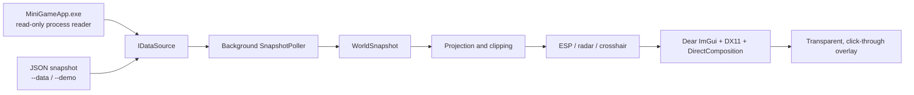

# MCP ESP Overlay

[繁體中文](README.md) · [English](README_EN.md) · [Detailed build and usage guide / 詳細步驟](docs/GETTING_STARTED.md)


A Windows real-time visualization overlay sample built with C++20, Win32, Direct3D 11, DirectComposition, and Dear ImGui. Data acquisition, world-to-screen projection, rendering, and controls are split into replaceable modules for learning about real-time visualization and rendering pipelines.

> **Data source:** In live mode, the C++ application reads a compatible MiniWorld process directly through read-only `ReadProcessMemory`. Cheat Engine MCP was used during development to inspect and verify data; it is not needed at runtime. `--data` and `--demo` load offline snapshots.

## Download

**Windows x64 · Portable**

[⬇️ Download the latest release from GitHub Releases](https://github.com/infycat/MiniWorldEsp/releases/latest)

GitHub automatically redirects this link to the latest stable release. The Releases page also provides release notes, previous versions, and a `SHA256SUMS.txt` integrity file. To receive update notifications, choose **Watch → Custom → Releases** in the repository header.

Download and open `mcp_esp_overlay.exe`, then select **Start ESP** in the launcher. To build from source or inspect the code, see the [build guide](docs/GETTING_STARTED.md).

## Features

| Area | What it does |
|---|---|
| Entities | Filters players, creatures, and other actors; optional relation, visibility, and distance filters. Relation filtering is only reliable when the source supplies team and game-rule metadata. |
| 2D / 3D boxes | Rectangular 2D outlines or 3D wireframe cubes, with independently adjustable color, opacity, face fill, and line width. Projected edges and faces are clipped against the view frustum. |
| Labels and health | Displays names, distance, health bars, and optional health numbers beside the distance label. Missing health data is never fabricated. |
| Antenna lines | Connects a selected screen anchor to the projected target position; opacity and width are adjustable. |
| Skeletons | Draws source-provided bone positions and links. Live mode does not call in-game bone functions and will not synthesize live skeletons. Demo data can use a clearly marked generic rig. |
| Entity count | Shows player, creature, actor, and object totals with a black text outline; color, font size, and screen X/Y position are adjustable. |
| Per-type ESP controls | Players, creatures, and other actors can independently toggle boxes, fills, names, distance, health, antenna lines, and skeletons. Global switches can still disable a feature for all types. |
| Objects | Shows object boxes, face fills, names, and distance. Object styling can be adjusted separately. |
| Radar | The radar title follows the selected GUI language. Player, creature, other-actor, and object markers can each be hidden independently; radius, range, and position are adjustable. |
| Launcher and localization | The executable opens a launcher first. Start ESP becomes unavailable while running and the Close ESP button stops the overlay. A single-instance guard prevents launching a second window; common internal labels such as `ClientItem123` are localized with the selected language. |
| Crosshair | Cross, circle, corner, or dynamic style; configurable size, gap, color, opacity, and thickness, plus an optional adjustable ring. |
| GUI language and themes | Switch between Traditional Chinese and English, and between Dark and White + Blue themes. Choices are saved beside the executable. |
| Diagnostics | The panel reports target and camera data age, update rate, matrices, entity counts, and draw skip reasons. `logs/esp.log` records rate-limited diagnostics. |

Press **Insert** to show or hide the control panel and switch menu interaction. The GUI and radar are interactive; the remaining overlay area passes clicks through to the game. Press **End** to exit.

## Data and limitations

- **Live mode (default):** Reads a running `MiniGameApp.exe` with query/read access only. It does not write game memory or inject code. Target data updates in the background while the camera matrices are refreshed each render frame to reduce box lag during fast turns. The current reader targets the game layout verified during development; updates may require revalidation.
- **JSON mode:** `--data <file>` reads a snapshot conforming to [the JSON schema](schemas/world_snapshot.schema.json). It is the main integration point for another data provider.
- **Demo mode:** `--demo` loads synthetic data and visibly labels the overlay `DEMO DATA - NOT LIVE GAME DATA`.
- Live actor lists are classified from runtime type labels. Team rules are not completely available in the current reader, so players remain unclassified when metadata is missing.
- Live skeleton attachment points depend on game methods or virtual functions. The external read-only reader does not invoke them; a provider must supply real bone coordinates for live skeleton rendering.

## Data flow



The source publishes complete snapshots on a background polling thread. The render loop consumes the newest snapshot, applies the view and projection matrices, clips geometry, and emits draw commands. Missing or invalid data is skipped and reported in diagnostics instead of being guessed.

See [docs/ARCHITECTURE.md](docs/ARCHITECTURE.md) for the module map and code-reading path, and [docs/source_notes.md](docs/source_notes.md) for version-specific research notes.

## Source tree

```text
MiniWorldEsp/
├── assets/                  # SVG/PNG/ICO icon and Win32 resource template
├── docs/                    # Architecture, source notes, and setup guide
├── schemas/                 # JSON snapshot schema
├── src/                     # C++ application source
│   ├── main.cpp             # Arguments and data-source selection
│   └── esp/                 # Types, readers, projection, drawing, Win32 GUI
├── tools/                   # Icon generation utility
├── dist/                    # One final, icon-branded Windows executable
├── sample_data.json         # Synthetic snapshot with bone data
├── sample_data_no_bones.json
├── CMakeLists.txt
├── LICENSE
└── README.md / README_EN.md
```

`src/` contains the application logic. `assets/`, `schemas/`, `docs/`, and `tools/` are required project resources and learning materials. `build-*` directories are generated by CMake and can be deleted and recreated. The two sample snapshots and demo rig source are used for offline testing, not dead code.

## Requirements

- Windows 10 or 11, 64-bit
- CMake 3.24 or newer
- Git
- Either Visual Studio 2022 with the Desktop development with C++ workload, or MinGW-w64
- Internet access during the first CMake configure, so FetchContent can download Dear ImGui and nlohmann/json

The release executable statically links the C++ runtime. It does not require a separate MinGW or Visual C++ Redistributable installation; Direct3D 11, DirectComposition, and the other runtime APIs are Windows system components.

Follow the [step-by-step build and usage guide](docs/GETTING_STARTED.md) for dependency installation, build commands, run modes, and troubleshooting.

## Snapshot contract

The format is defined in [schemas/world_snapshot.schema.json](schemas/world_snapshot.schema.json). A valid snapshot provides camera position and forward direction, 16-element view and projection matrices, entities, and objects. Matrices are column-major and use Direct3D's `[0, w]` depth range. To determine friend/enemy relations, provide `localTeam`, `attackPlayerRule`, and each player's `team`.

Providers should write a complete temporary file, flush it, and atomically rename it over the target snapshot. Bone positions use world coordinates in `bones`; `bone_links` defines connected name pairs. Live mode skips skeletons when real bones are unavailable.

## Suggested learning path

1. Read `src/esp/types.hpp` for the shared data contract.
2. Read `src/esp/data_source.cpp` to follow JSON validation and snapshot polling.
3. Read `src/esp/projection.cpp` for matrix projection, clipping, and screen coordinates.
4. Read `src/esp/draw_esp.cpp` to see snapshots become ImGui draw commands.
5. Read `src/esp/overlay_app.cpp` for Win32, Direct3D 11, DirectComposition, GUI, and hit testing.
6. Read `src/esp/live_process_source.cpp` for process lifetime, read-only memory access, pointer checks, and failure handling.

## License

Distributed under [LICENSE](LICENSE). Third-party dependencies retain their respective upstream licenses and notices.
