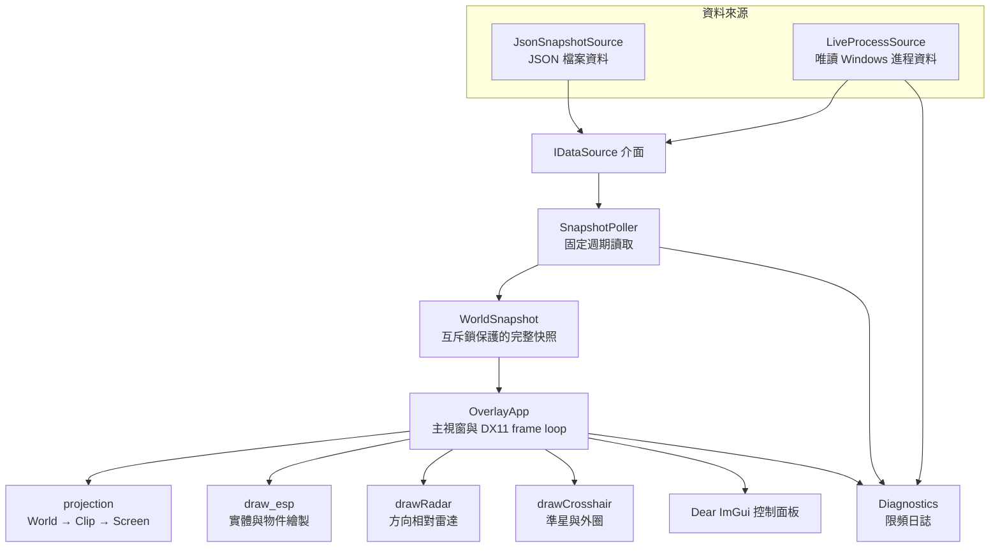
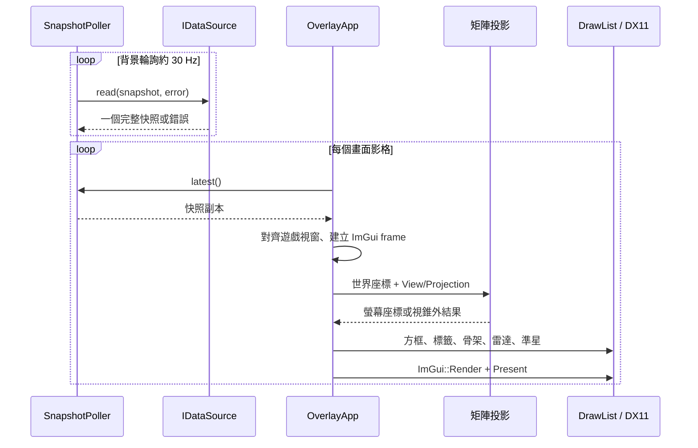

# 架構與程式導讀

本文以實際原始碼為準，說明各模組的責任、資料經過的步驟、幾何投影概念，以及加入新資料來源或新繪圖項目的方法。

## 1. 執行時模組圖



資料來源介面只有一個讀取操作：`IDataSource::read(WorldSnapshot&, std::string&)`。實作需將一個完整影格寫入輸出參數，成功時回傳 `true`；失敗時提供錯誤文字，不應把半成品當作有效快照。

`SnapshotPoller` 在背景執行緒按預設約 33 毫秒間隔輪詢。每次成功讀取會更新序號及取樣時間，然後在 mutex 保護下替換最新快照。渲染執行緒只複製最新快照，不等待底層讀取完成。

## 2. 每幀繪製流程



資料讀取頻率和畫面更新頻率是兩個概念。資料來源偶爾延遲時，Overlay 仍能繪製最後一個完整快照；下一次輪詢確認資料失效或遊戲進程消失時，poller 會清除世界快照，避免留下舊框。

## 3. 座標與投影

每個世界點依次通過 view 和 projection 矩陣：

```text
clip = Projection × View × worldPosition
ndc  = clip.xyz / clip.w
pixel.x = (ndc.x * 0.5 + 0.5) * viewportWidth
pixel.y = (0.5 - ndc.y * 0.5) * viewportHeight
```

`projection.cpp` 負責這項轉換。`draw_esp.cpp` 的 3D 框不是只投影八個頂點後硬連線：它會在齊次 clip space 對 12 條邊分別裁切，並對 6 個面做多邊形裁切。如此當角點在鏡頭後方或靠近近平面時，其他仍可見的線段和面不會因單一角點而整個消失，也不會把遠端線條延伸到視窗之外。

座標單位必須一致。即時 reader 以引擎座標及快照內的來源單位比例計算距離；JSON reader 的預設約定是座標以米表示（`unitsPerMeter = 1`）。View、Projection、相機位置、實體位置與骨點必須來自同一影格／座標系。

## 4. 源碼責任表

| 檔案 | 責任 | 閱讀時關注 |
|---|---|---|
| `src/main.cpp` | 解析 `--live`、`--demo`、`--data`，建立資料來源和應用程式 | 預設 live；demo JSON 明確標示為合成資料 |
| `src/esp/types.hpp` | `Vec*`、`Mat4`、`Entity`、`WorldSnapshot`、`Settings` | 跨模組資料契約；可選資料用 `std::optional` 表示 |
| `src/esp/data_source.hpp/.cpp` | `IDataSource`、JSON reader、快照背景輪詢器 | 驗證矩陣、座標、實體、物件與骨架連線 |
| `src/esp/live_process_source.cpp` | 連接目標進程並唯讀複製資料 | 模組基址重查、指標／陣列邊界驗證、失效時拒絕快照 |
| `src/esp/projection.hpp/.cpp` | 世界座標投影及螢幕座標轉換 | 矩陣布局和 clip-space 邊界條件 |
| `src/esp/draw_esp.hpp/.cpp` | 實體、物件、雷達、準星等 ImGui 繪圖 | 篩選規則、方框幾何、透明度、文字描邊和統計 |
| `src/esp/rigs.hpp/.cpp` | Demo 用通用骨架連接關係 | 只應用在 demo，不能當成 live 骨骼讀取結果 |
| `src/esp/overlay_app.hpp/.cpp` | Win32 視窗、遊戲視窗定位、DX11、ImGui、GUI | 點擊穿透、Insert 互動切換、End 結束、控制面板 |
| `src/esp/diagnostics.hpp/.cpp` | 限頻日誌和日誌路徑 | 區分資料讀取錯誤、投影跳過與繪圖結果 |
| `schemas/world_snapshot.schema.json` | JSON 快照格式的機器可讀契約 | 第三方 provider 應先符合這個 schema |
| `docs/source_notes.md` | 遊戲版本資料驗證研究紀錄 | 研究紀錄不是跨版本 ABI 保證 |
| `tools/generate_icon.py` | 以 Pillow 產生圖標 PNG 與多尺寸 ICO | 重新產生圖標時才需要 Python Pillow，不是 EXE 執行相依項 |

Windows 圖標由 `assets/app.rc.in` 編譯成 PE 資源。`overlay_app.cpp` 使用相同資源 ID 呼叫 `LoadIconW`，因此檔案圖標和 Win32 視窗圖標一致；載入發生在 EXE 內，不需旁置 ICO 檔。

## 5. 功能如何映射到程式

### 實體與物件

`Entity` 保存識別碼、名稱、類別、關係、位置、半尺寸、速度、選填血量／隊伍／可見性及骨點。`WorldObject` 保存物件名稱、類別、位置、尺寸與可見性。`drawWorld()` 先計數，再呼叫對應繪圖路徑；篩選結果會累積到 `DrawStats`，GUI 可以看到哪些目標因類別、關係、距離、矩陣或視錐被略過。

### 方框與文字

2D 框以可見 3D 邊的螢幕包圍盒作為矩形；3D 框繪製各邊和面。邊線和面透明度各自獨立。玩家顏色可按 friend/enemy 關係套用；若 snapshot 沒有規則和隊伍，就使用中立／未分類路徑，不猜測隊伍。

文字以單次前景繪製加深色描邊改善可讀性。距離由相機位置和世界位置換算；血量只有在來源同時提供有效 `health` 和 `maxHealth` 時才繪製。

### 骨架

繪圖器不依賴固定模型。每個 entity 的 `bones` 是骨點名稱到世界座標的映射，`bone_links` 提供線段端點名稱。若某個連接端點缺少，該線段略過。demo 才能選擇根據方框尺寸補一個通用骨架；live snapshot 不套用這個 fallback。

### 雷達與準星

雷達以玩家為原點，使用相機 forward/right basis 將世界差值投影到 2D 圓盤，並依可設定量程裁掉圓盤外目標。GUI 支援直接拖移，另有位置滑桿。準星採螢幕中心定位，樣式由 `Settings.crosshairStyle` 選擇，外圈作為獨立圖層。

### Win32 / Direct3D 視窗

Overlay 搜尋 `MiniGameApp.exe` 的可見視窗，讀取遊戲 client rect 後同步位置和大小。視窗使用置頂與非啟用焦點標誌；`WM_NCHITTEST` 只對控制面板／雷達回傳可互動區域，其餘位置回傳 `HTTRANSPARENT`。這是繪製穿透與操作面板共存的關鍵。

## 6. 增加新資料來源

1. 在 `types.hpp` 確認要新增的欄位應屬於實體、物件、相機或快照層級。
2. 實作 `IDataSource`，讀取並驗證完整資料後才發布 `valid=true`。
3. 保持來源座標系、單位與相機矩陣一致；無法讀取的值留空或標為 unavailable。
4. 以 JSON snapshot 作為測試輸入，先驗證投影和繪圖，不需啟動遊戲。
5. 為讀取失敗和分類結果增加有節制的日誌，避免每幀大量輸出。

## 7. 增加新視覺元素

1. 在 `Settings` 加入預設狀態和顏色／尺寸參數。
2. 在 `OverlayApp::renderGui()` 加入控制項，標籤清楚指出單位（px、m、0–1）。
3. 在 `draw_esp.cpp` 新增純繪圖函式，將資料和設定當作參數傳入，不直接讀取進程或持有 UI 狀態。
4. 把資料不足、被篩選、裁切出畫面的情況納入統計；不要用合成座標掩蓋失敗。
5. 用 JSON fixture 測試中心、畫面邊緣、近平面附近和資料缺失情況。

## 8. 支援範圍與誠實限制

* 視窗和 DX11 部分支援 Windows 10/11 x64。發佈版會靜態連結 C++ runtime，但仍使用 Windows 提供的圖形與 API-set 系統 DLL。
* live reader 的記憶體布局是針對一個已檢查的遊戲版本。遊戲更新後應重新驗證模組與資料，不應只因舊位址仍可讀就假設資料正確。
* 即時骨架需要遊戲內骨骼 bind-point 函數提供當前姿勢；本專案不在外部 reader 中呼叫它，因此 live 沒有真實骨點時就不繪製骨架。
* 即時隊伍／敵我規則若未提供，介面不應把未分類玩家冒充敵人或隊友。JSON provider 可提供 `localTeam`、`attackPlayerRule`、`team` 以使用明確規則。
* 外部資料 provider 必須提供與實體同影格的 camera eye、forward、view matrix 和 projection matrix；錯誤矩陣會令所有 ESP 偏移或消失。
